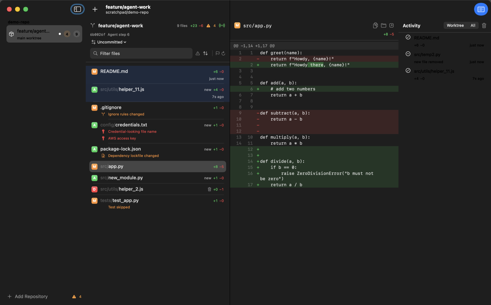

# Vigil

[](https://github.com/CocoaBeans/vigil/actions/workflows/ci.yml)


[](LICENSE)

A small, native macOS app that keeps watch over git worktrees while coding agents work in them. It sits beside Claude Code, Codex, Aider, Cursor or whatever you run, and answers two questions at a glance: **what is it doing right now**, and **should I be worried**.

Vigil is strictly read-only. It never stages, commits, checks out, or takes the repository's `index.lock`, so it can watch any repository while another tool is busy in it.



## Why

Git clients are built for committing. When an agent is editing on your behalf, you want something closer to a monitor: it should refresh by itself, show you what changed in the last minute, keep showing you the whole session's work even after the agent commits, and point out the handful of changes that deserve a human look before anything ships. Vigil is that monitor.

## What it does

- **Watches live.** FSEvents on the worktree and the git directory drive refreshes a few hundred milliseconds after files settle. Recently touched files glow and say "12s ago", so you can see where the agent is working. Each file shows an icon for its kind and a five-block diff bar: the more lines changed, the more blocks light (green for added, red for removed), so the big edits stand out in any list. Bursts that only touch ignored paths (build output, `node_modules`) are discarded without a refresh.
- **Compares against the right baseline.** Agents commit as they go, so a plain working-tree diff goes blank after each commit. Switch between:
  - *Uncommitted*: working tree versus HEAD, including untracked files.
  - *Since branch point*: everything since the branch diverged from the default branch (or from its upstream when you are on the default branch).
  - *Since start*: everything since you pressed **Mark Start**.
  - *Since snapshot*: any earlier snapshot Vigil recorded.
- **Follows every worktree.** Add a repository and Vigil discovers its linked worktrees (for example the ones agent tools create under `.claude/worktrees/`) and watches them all. Repositories collapse in the sidebar; worktrees you do not care about can be hidden, and the filter button at the bottom narrows the list to worktrees with an agent at work. Stop watching a repository from any of its rows' context menu, the File menu (⌘⌫), or the Delete key.
- **Flags what deserves a look.** Lockfiles, `.env` and key material, secret-looking strings in added lines, CI and agent instruction files, `.gitignore` edits, mass deletions, deleted or skipped tests, conflict markers, lint suppressions, debug leftovers, permission changes, huge files, and edits outside a scope you define. Click the orange count to see every flagged file and why. Every rule can be switched off and thresholds are adjustable.
- **Shows diffs the way you read them.** Unified or side-by-side (⌥⌘L), with line numbers, syntax colors for about 25 languages and formats, word-level emphasis on the parts of a line that actually changed, wrapping or horizontal scrolling, copy as a patch, and flags that jump to the offending line. Each hunk's header stays at the top while you scroll through it, and on longer diffs a strip beside the diff marks where the added and removed lines are, with a box around what is on screen; click or drag on it to go there. ⌘F filters the file list. The highlighter is built in, with no dependencies, and runs off the main thread once per diff.
- **Lists the branch's commits.** The Changes | Commits switch at the top of the file list (⇧⌘H) shows the worktree's commits: first what the branch added since it left the default branch (on the default branch itself, what is not in its upstream yet), then earlier history, 100 commits at a time. Each row shows who made it, when, and how much it changed. Select a commit to read its message and expand it to its files, then pick a file for its diff, compared with the commit's parent (a merge with its first parent). A commit's files get the same attention flags as working-tree changes and are listed 100 at a time, those needing attention first, so a commit that touches thousands of files stays quick to open. The list updates as new commits land, and a commit in the activity feed opens it here.
- **Remembers what you have reviewed.** Mark a file reviewed (⌘↩ marks it and moves to the next one) and it dims in the list. The header's **To review** count is also a filter (⌥⌘R) that shows only what is left, and while any filter hides files a bar under the list says how many. A mark covers the content you saw, so when an agent edits the file again it comes back as *changed since your review*, and the diff can show just the edits made after you looked. Each sidebar row shows its counts as chips that say what they count: ± changed files, 👁 left to review once you start, ✓ when all are reviewed, ⚠ files that need a look. A worktree with an agent leads with the agent's badge and a short status ("Needs permission", "Working · Bash").
- **Writes up a session.** ⇧⌘E (or the document button by the filter) opens a Markdown summary of a worktree's session in a window of its own, one per worktree, to move and resize beside your work: what changed, what needs attention and why, what you have reviewed, the commits since the baseline, and what the agent did, with diffs if you want them. It gathers itself again a couple of seconds after the worktree changes (with diffs included, it says it is out of date and waits for Refresh, since every diff is read again). Preview it, then copy it into a pull request description or save it as a handoff note.
- **Records snapshots.** When the tree changes, Vigil writes a commit object of the whole working tree (untracked files included) under `refs/monitor/<worktree-id>/`. Branches, the index and the working tree are untouched. Snapshots keep the Start marker alive across restarts and let you compare against any earlier moment.
- **Keeps an activity feed.** Created, modified, deleted and reverted files, commits, branch switches, new flags and agent work, newest first, for one worktree or all of them. Click an entry to jump to the file. The feed is saved to disk and kept for a week by default (Settings › General), so it and session summaries survive a restart. Its filter menu shows agents only (their events and the changes traced to them) or hides agents' own events.
- **Knows where the agents are.** Vigil scans for agent processes (Claude Code, Codex, Aider, Cursor, Gemini, Goose, OpenCode, Amp, or names you add) and shows which worktree each one is working in. With hooks connected (one reversible click for Claude Code and Hermes, a setup to paste for Codex, Gemini CLI, Cursor or any agent that can run a command) it also knows exactly what the agent is doing: when a turn starts and ends, each tool call, and when it needs your permission or asks you a question. A finished turn reads as ready for your next prompt and does not count as needing you. File changes are attributed to the tool call that made them, worktrees that need you are counted in the sidebar and the menu bar, and you can be notified when an agent needs permission or has a question.
- **Shows who needs you in the toolbar.** A pill in the middle of the toolbar names the agent waiting on you longest, in any worktree ("Codex needs you · plan · 42s"), or how many are working. Click it for that agent's banner, with its task, steps and files, and every other agent; click one to show its worktree.
- **Has an Agents window.** ⇧⌘A (or the toolbar's Agents button, or the menu bar) lists every worktree with an agent in it: what it is doing and for how long, the task it was given, its last few steps, the files it has touched this turn (click one to open its diff), and how much is changed and left to review. Each agent is a card tinted by its state, grouped under Needs you, Working, Ready and Ended; those waiting on you come first, longest wait first. Under each agent a thin strip lays its turn's tool calls along time, coloured by kind (blue edits, green commands, grey reads and searches, red failures, orange waiting on you), so you can see the turn's rhythm and when an agent has gone quiet; after three minutes without a tool call, the strip ends with "quiet 4m". Go to agent and Summary appear in place of the step count when you point at a card, and an agent waiting on you keeps a tinted Go to agent button, since that is where you answer it. Widen the window past about 900 points and the cards flow into two columns. Click a section's heading to fold it away; folded, it still shows each agent's badge, and Vigil remembers which sections you folded. **Go to agent** brings the app the agent runs in (Terminal, iTerm, VS Code, the Claude or Hermes app) to the front. Click a row to jump to that worktree, switch off Details for one line per agent, or pin the window above everything else.
- **Lives in the menu bar.** A glance shows total changed and flagged files, and how many agents are waiting for you. Click it for a popover drawn like the desktop widget: each agent at work with a live timer, its task and latest steps, then every repository and worktree with what changed. Click an agent or a worktree to open it in Vigil.


## Requirements

- macOS 15 or later (developed on macOS 26).
- A `git` binary. Homebrew or MacPorts git is preferred; the Xcode shim at `/usr/bin/git` works when the Command Line Tools are installed. A custom path can be set in Settings.
- Xcode 16 or later (Swift 6) to build from source.

## Install

Until signed releases exist, build it yourself. It takes about a minute:

```bash
git clone https://github.com/CocoaBeans/vigil.git
cd vigil
VIGIL_SIGN=adhoc Scripts/make-app.sh release
open build/Vigil.app
```

Or `Scripts/run.sh` for a debug build that opens immediately. You can also run `swift run Vigil`, or open `Package.swift` in Xcode and run the `Vigil` scheme. Notifications only work from the app bundle.

`VIGIL_SIGN=adhoc` signs the app ad hoc, since the Xcode project is set up for the maintainer's team; the first launch may ask you to confirm in System Settings › Privacy & Security, or you can right-click the app and choose Open. An ad-hoc build's desktop widget cannot read Vigil's data, which needs a team-signed App Group; [CONTRIBUTING](CONTRIBUTING.md#signing-with-your-own-team) explains how to build with your own team.

### Try it with a simulated agent

```bash
Scripts/simulate-agent.sh
```

This creates a throwaway repository, prints its path, and then edits, adds, deletes and commits files every few seconds, including a few changes that should be flagged. Add the printed path to Vigil and watch.

## How it works

- **VigilCore** (`Sources/VigilCore`) is a UI-free library: a typed git client, parsers for `status --porcelain=v2`, `diff --raw`, `--numstat` and unified patches, an FSEvents wrapper, the attention heuristics, an intraline diff, the activity differ, and the `WorktreeInspector` actor. The SwiftUI app in `Sources/Vigil` is a thin shell over it.
- **Shadow index.** Each worktree gets a private git index file in `~/Library/Application Support/Vigil/index/`. Every refresh runs `git add -A` against that file (with `GIT_INDEX_FILE`), which mirrors the working tree, honours ignore rules, and never touches the repository's own index. `git diff --cached <baseline>` against the shadow index then yields a complete, rename-aware diff that includes untracked files. Untracked files above a size limit are skipped and listed in the header.
- **No lock contention.** Every git invocation runs with `--no-optional-locks`, so `git status` from Vigil never writes the repository index and never races an agent for `index.lock`.
- **Snapshots** are `commit-tree` objects (parent: current HEAD) referenced from `refs/monitor/<id>/snapshots/<unix-ms>`, plus `refs/monitor/<id>/start` for the Start marker. They show up in `git log --all`, never in `git branch`, and are not pushed by a normal `git push`. Remove them from Settings, or by hand:

  ```bash
  git for-each-ref --format='%(refname)' refs/monitor | xargs -n1 git update-ref -d
  ```

  Settings › Snapshots shows how much disk space the selected worktree's snapshots use on their own: the objects no branch, tag, other ref, worktree HEAD or index keeps (`git rev-list --objects-edge-aggressive --disk-usage`, git 2.38 or later). Deleting the snapshots frees that space the next time `git gc` prunes unreachable objects, which by default waits about two weeks.

- **Review marks** record, per file, the blob you saw (from the shadow index). Comparing that against the current blob tells reviewed, unreviewed and changed-since-review apart, and `git diff <reviewed blob> <current blob>` gives the since-review diff. Marks live with the worktree's settings in `state.json`; blobs nothing else references are eventually pruned by `git gc`, after which only the full diff is available.
- **Refresh pacing.** File events are debounced (default 400 ms) with a maximum delay (default 2.5 s) so continuous churn still refreshes. Changes inside folders git ignores (`.build`, `node_modules`) are recognized once and skipped from then on, so a build does not set off refreshes. File events are reliable, so the quiet, staggered backstop poll runs only every 10 minutes per worktree, plus once for every worktree when the Mac wakes from sleep.

## Agents and hooks

Without any setup, Vigil detects agent processes by their working directory and shows them on the worktree they sit in. That tells you an agent is there and whether it is busy, nothing more.

Hooks tell Vigil what the agent is doing. **Settings › Agents › Hooks › Install Hooks** adds entries to `~/.claude/settings.json` for Claude Code's `SessionStart`, `UserPromptSubmit`, `PreToolUse`, `PostToolUse`, `PostToolUseFailure`, `PostToolBatch`, `PermissionRequest`, `PermissionDenied`, `Notification`, `Stop`, `StopFailure`, `SubagentStop` and `SessionEnd` events. Each entry runs:

```bash
curl -s -m 1 -H 'Expect:' -H 'Content-Type: application/json' \
  --unix-socket "$HOME/Library/Application Support/Vigil/vigil.sock" \
  --data-binary @- http://vigil/event >/dev/null 2>&1 || true
```

A timestamped backup of the settings file is written first, hooks you already have are kept, and **Uninstall Hooks** removes only Vigil's entries. When a newer Vigil listens to events an older one did not install, it adds them at launch the same way (backup first).

A tool call ends in `PostToolUse` when it succeeds, `PostToolUseFailure` when it fails (a command exiting non-zero) or is interrupted, and only `PostToolBatch` when you deny it; a turn ends in `Stop`, or `StopFailure` after an API error. Claude Code sends nothing between your approval of a command and the command finishing, so while a shell command waits on your permission Vigil looks for the shell Claude Code starts for it (every 1.5 seconds, only while one waits). Once that is running, the agent shows as working instead of still needing you through a long build or test run. When Vigil is not running the command fails silently in under a second, so agents are never slowed down.

Hooks only report what happens while Vigil runs: a session sitting at its prompt when Vigil starts sends nothing until you next use it, and one started before the hooks were installed never sends anything. For those, Vigil reads the small file Claude Code keeps for each running session in `~/.claude/sessions/<pid>.json` (read only) and shows whether it is working, ready or waiting on you, until the session's first hook event takes over. The same file ties a Claude Code process to its session, so a session that moves into another worktree (say, from the repository into one of its worktrees) shows there, process and all, instead of leaving a bare process behind in the folder it started in. Events are kept in memory only; nothing is written to disk and nothing leaves the machine. **Hermes Agent** is supported the same way. **Install Hermes Hooks** writes a small script to `~/.hermes/agent-hooks/vigil.sh` and appends a delimited `hooks:` block to `~/.hermes/config.yaml` (backup first). If your config already has a `hooks:` key, Vigil copies the entries to the clipboard for you to paste instead. Hermes runs a hook only after you approve it, and its gateway has no terminal to ask from, so it skips unapproved hooks silently. Run `hermes --accept-hooks` once in a terminal (or plain `hermes` and answer each prompt), then open a new session; Settings › Agents › Hooks shows how many of Vigil's hooks are still waiting for approval. Events arrive on `http://vigil/event/hermes` and are translated from Hermes's names (`pre_tool_call`, `pre_approval_request`, `on_human_input_request`, `pre_verify`, …). Hermes's hooks report the gateway's own directory, not the project, so Vigil reads where each session works from Hermes's `~/.hermes/state.db` (read only) and shows the session there from its first event; a file it changes in another worktree moves it there.

### Several agents in one worktree

Two agents working in the same folder can undo each other's work. Vigil keeps each session apart, by the `session_id` its hooks send (subagents share their parent's), and counts an agent process that no session accounts for once two scans have seen it and no other agent there started it. A session counts while it is live: it has not ended, and it reported in the last 10 minutes or its process still runs.

When a worktree has more than one live agent, the sidebar, menu bar and Agents window say how many, and the banner lists the others under **Also here**, each with Go to agent. When two of them edit the same file (both edits within 30 minutes, one of them in the last 10), the banner leads with a warning naming the files, the worktree counts as needing you, the activity feed records it, and a notification is posted (Settings › Agents › Notifications, on by default). **Dismiss** quiets it until they edit another file in common. A shell command that names no file cannot be matched, and an agent whose hooks send no session id counts once per worktree.

### Connecting other agents

Any agent that can run a command when something happens can report to Vigil the same way. **Settings › Agents › Other Agents** shows what to paste into Codex (`~/.codex/hooks.json`), Gemini CLI (`~/.gemini/settings.json`) or Cursor (`~/.cursor/hooks.json`), with a Copy button, and lists every agent that has reported since Vigil started, so you can see a new setup work. Vigil never edits those files; remove the entries yourself to stop. Every setup runs the same command, with the agent's name in the address:

```bash
curl -s -m 1 -H 'Expect:' -H 'Content-Type: application/json' \
  --unix-socket "$HOME/Library/Application Support/Vigil/vigil.sock" \
  --data-binary @- 'http://vigil/event?agent=codex' >/dev/null 2>&1 || true
```

The hook's JSON goes in on standard input, as each agent writes it. Vigil understands each agent's own names for the same moments and maps them onto one set:

| Moment | Claude Code, Codex | Gemini CLI | Cursor | Hermes | Plain name |
|---|---|---|---|---|---|
| Session opened | `SessionStart` | `SessionStart` | `sessionStart` | `on_session_start` | `session_start` |
| Prompt sent, turn starts | `UserPromptSubmit` | `BeforeAgent` | `beforeSubmitPrompt` | `pre_llm_call` | `turn_start` |
| About to use a tool | `PreToolUse` | `BeforeTool` | `preToolUse` | `pre_tool_call` | `tool_start` |
| Tool finished | `PostToolUse` | `AfterTool` | `postToolUse` | `post_tool_call` | `tool_end` |
| Tool failed | `PostToolUseFailure` | `AfterTool` with an error | `postToolUseFailure` | | `tool_failed` |
| Waiting for your permission | `PermissionRequest` | `Notification` (`ToolPermission`) | | `pre_approval_request` | `needs_permission` |
| Asked you something | `Notification` | | | `on_human_input_request` | `question` |
| Turn finished | `Stop`, Codex's `Interrupt` | `AfterAgent` | `stop` | `pre_verify` | `turn_end` |
| Turn failed | `StopFailure` | | `stop` with status `error` | | `turn_failed` |
| Session closed | `SessionEnd` | `SessionEnd` | `sessionEnd` | `on_session_end` | `session_end` |

For an agent of your own, use the plain names with the fields Claude Code uses: `{"event": "tool_start", "session_id": "…", "cwd": "/path/to/worktree", "tool_name": "Edit", "tool_input": {"file_path": "src/a.py"}}`. `file_path` and `command` may also sit at the top level, and `message` carries a question's text. The address takes two optional parameters:

- `agent=<name>` names the agent. Without it, Vigil asks macOS which process is on the other end of the socket and walks up from there to the agent that ran the hook (the same detection as above, including names you added), then falls back to what the event's names suggest.
- `event=<name>` names the event, for an agent whose hook sends no JSON or names its events in a way Vigil does not know. An empty body is fine with it: `curl … --data-binary '' 'http://vigil/event?agent=aider&event=turn_end'`. Without a `cwd` in the payload, Vigil uses the hook command's working directory.

What Vigil can show depends on what an agent sends: start and end of a turn give working and ready; tool events add each step and which edit changed which file; permission and question events make it count as needing you, with notifications. Without a session id, a worktree holds one session at a time.

## Desktop widgets

Add the **Agents** widget from the desktop's **Edit Widgets** menu (or Notification Center) to see your agents without opening Vigil, the one that needs you first. **Small** shows that agent, how long it has been waiting or working, and how many others there are. **Medium** lists three, **large** three with each one's task and latest steps (four without), and **extra large** eight in two columns. Click an agent to open Vigil on its worktree. Each widget can be set (Edit Widget) to hide tasks and steps, or to show only agents that need you; **Settings › Agents › Feed & Widgets › Show tasks and steps in widgets** keeps them off every widget, since anyone near the screen can read them.

The widget is an app extension running sandboxed in its own process. Vigil writes what it shows to `widgets.json` in the App Group container `~/Library/Group Containers/555LXJXR4U.com.kevinross.Vigil/` and asks WidgetKit to reload: at once when an agent starts or stops needing you, otherwise at most every 10 seconds, plus every 15 minutes so the widget can tell a quiet Vigil from one that has quit. When Vigil quits, or has written nothing for 45 minutes, the widget says Vigil isn't running rather than show stale states. Timers ("Waiting 2:03") tick on their own between reloads.

## Privacy and footprint

Vigil talks to nothing but your local `git`. It has no network code beyond a Unix-domain socket that only your own processes can reach (the socket file is readable and writable by you alone), and no telemetry. On disk it writes:

- `~/Library/Application Support/Vigil/`: settings, the list of watched repositories, review marks, the shadow index files, and `activity.jsonl`, the activity feed (one JSON entry per line, kept for the number of days you choose).
- `refs/monitor/…` inside watched repositories, for snapshots (see above).
- `~/.claude/settings.json`, only when you click Install Hooks or a newer Vigil adds events to hooks you installed, with a backup beside it.

## Development

Open `Vigil.xcodeproj` in Xcode to build, run and sign the app: the **Vigil** app target over a **VigilCore** static framework, signed automatically with the project's team. Both targets use folder-synchronized groups, so a Swift file added under `Sources/Vigil` or `Sources/VigilCore` is part of the build without editing the project.

```bash
Scripts/make-app.sh             # build/Vigil.app via xcodebuild, team-signed (debug|release)
VIGIL_SIGN=adhoc Scripts/make-app.sh   # signed ad hoc, for a Mac without the team's certificate
swift test                      # parsers, rules, differ, plus integration tests against real git
swift build                     # the same app as a Swift package, for `swift run` and the debug hooks
```

### App icon

The icon, a vigil flame keeping watch over a branch graph, is drawn from shapes by `Scripts/make-icon.swift`, which writes every size into `Resources/AppIcon.icns`. Small sizes get bolder lines. After changing the drawing, regenerate it and rebuild:

```bash
swift Scripts/make-icon.swift
```

### Debug hooks

Environment variables for driving the app headlessly, useful on machines without screen-recording permission:

| Variable | Effect |
|---|---|
| `VIGIL_SCREENSHOT=/path.png` | Write the main window (and any popover) to PNG after launch |
| `VIGIL_SCREENSHOT_INTERVAL=5` | Rewrite it (and the dump) every 5 seconds |
| `VIGIL_DEBUG_DUMP=/path.txt` | Write a text summary of repositories, sessions, changes and activity |
| `VIGIL_DEBUG_SELECT=src/app.py` | Select that file in the selected worktree once it appears |
| `VIGIL_DEBUG_REVIEW=README.md,src/app.py` | Mark those files in the selected worktree reviewed once they appear |
| `VIGIL_WINDOW=1000x640` | Resize the main window after launch (clamped to the content minimum) |
| `VIGIL_DEBUG_FLAGS=popover:sidebar,cycle` | Open the attention popover; cycle the selection through all worktrees; `toggle-review` presses ⌘↩ once on the selected file; `agents-window` opens the Agents window; `summary` opens the session summary and writes it next to the dump; `widgets` renders every widget size, light and dark, next to the dump; `open-runs` opens every agent run in the activity feed; `menu-bar` opens the menu-bar popover and renders it; `status-pill` opens the toolbar pill's popover and renders it; `sidebar` renders the sidebar rows with agents or changes; `diff-line:<n>` scrolls the selected file's diff to new-file line n. With `settings:agents`, `agents:hooks`, `agents:other`, `agents:widgets` or `agents:notifications` opens that part of Settings › Agents. `VIGIL_QUIET_AFTER=<seconds>` shortens how long a working agent goes without a tool call before it counts as quiet. Renders sit next to the dump, in light and dark, since live captures lose vibrant colours |
| `VIGIL_SCREENSHOT_WINDOW=Agents` | Capture the window with that title instead of the main window |
| `VIGIL_SUPPORT_DIR=/tmp/vigil-scratch` | Keep state, shadow indexes and the hook socket in that folder, leaving your real setup alone |

Example: `open --env VIGIL_SCREENSHOT=/tmp/vigil.png build/Vigil.app`

### Releasing

`Scripts/release.sh` builds, signs with a Developer ID certificate, notarizes with `notarytool` and staples the ticket. It needs the certificate in the login keychain and an App Store Connect API key passed as `ASC_KEY_ID` and `ASC_ISSUER_ID` (the key file is read from `~/.appstoreconnect/private_keys/`).

## Ideas not built yet

- A read-only transcript adapter for agents without hooks installed.
- A timeline scrubber across snapshots.
- A gated "discard this hunk" escape hatch.

## Contributing

Issues and pull requests are welcome. [CONTRIBUTING](CONTRIBUTING.md) covers building with your own signing team, where code belongs, tests, and how to report a security problem privately.

## License

[MIT](LICENSE)
