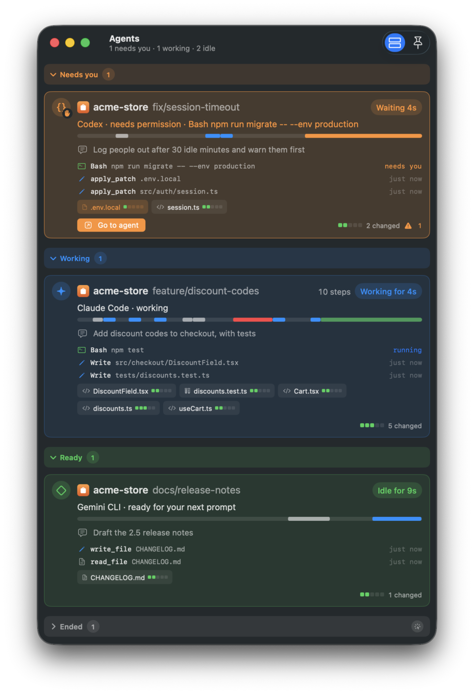
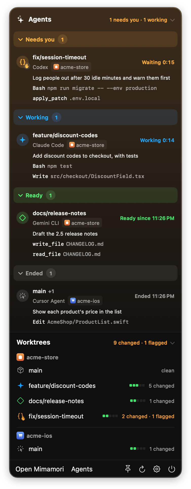

# Mimamori

*Mimamori* (見守り, mee-mah-MOH-ree) is Japanese for watching over someone with care: the way you watch children at play, ready to step in.

[](https://github.com/CocoaBeans/mimamori/actions/workflows/ci.yml)


[](LICENSE)

A lightweight mac app that keeps watch over git worktrees while coding agents work. It sits beside Claude Code, Codex, Aider, Cursor or whatever you run, and answers two questions at a glance: **what is it doing right now**, and **should I be worried**.

Mimamori is read-only unless you turn on one of its two escape hatches: discarding a hunk or a file, or putting an idle agent to sleep. It never stages, commits, checks out, or takes the repository's `index.lock`, so it can watch any repository while another tool is busy in it.


## Why

Git clients are built for committing. When an agent is editing on your behalf, you want something closer to a monitor: it should refresh by itself, show you what changed in the last minute, keep showing you the whole session's work even after the agent commits, and point out the handful of changes that deserve a human look before anything ships. Mimamori is that monitor.

## What it does


- **Watches live.** FSEvents on the worktree and the git directory drive refreshes a few hundred milliseconds after files settle. Recently touched files glow and say "12s ago", so you can see where the agent is working. Each file shows an icon for its kind and a five-block diff bar: the more lines changed, the more blocks light (green for added, red for removed), so the big edits stand out in any list. Bursts that only touch ignored paths (build output, `node_modules`) are discarded without a refresh.
- **Compares against the right baseline.** Agents commit as they go, so a plain working-tree diff goes blank after each commit. Switch between:
  - *Uncommitted*: working tree versus HEAD, including untracked files.
  - *Since branch point*: everything since the branch diverged from the default branch (or from its upstream when you are on the default branch).
  - *Since start*: everything since you pressed **Mark Start**.
  - *Since snapshot*: any earlier snapshot Mimamori recorded.
- **Follows every worktree.** Add a repository (⌘O, or drop its folder on the sidebar or on Mimamori's Dock icon, or run `open -a Mimamori <folder>`) and Mimamori discovers its linked worktrees (for example the ones agent tools create under `.claude/worktrees/`) and watches them all. Repositories collapse in the sidebar; worktrees you do not care about can be hidden, and the filter button at the bottom narrows the list to worktrees with an agent at work. Stop watching a repository from any of its rows' context menu, the File menu (⌘⌫), or the Delete key.
  - Each repository wears its own icon when Mimamori finds one (an Xcode app icon, a Mac `.icns`, an Android launcher icon, or a web app's touch icon or favicon), or else its initials on a muted colour taken from the icon or the name. The same mark heads its section in the sidebar and the menu bar and tags its agents' rows, so you can tell repositories apart at a glance. Pick another colour, or set the icon aside, from the repository's context menu.
- **Flags what deserves a look.** Lockfiles, `.env` and key material, secret-looking strings in added lines, CI and agent instruction files, `.gitignore` edits, mass deletions, deleted or skipped tests, conflict markers, lint suppressions, debug leftovers, permission changes, huge files, and edits outside a scope you define. Click the orange count to see every flagged file and why. In the diff, a flagged line takes its flag's colour (orange, or red for a secret or conflict marker) with a stripe down its edge and the reason on hover, and the strip beside a long diff marks where those lines are. Every rule can be switched off and thresholds are adjustable.
- **Shows diffs the way you read them.**
  - Unified or side-by-side (⌥⌘L), with line numbers, syntax colors for about 25 languages and formats, and word-level emphasis on the parts of a line that actually changed. The highlighter is built in, with no dependencies, and runs off the main thread once per diff.
  - Wrapping or horizontal scrolling, copy as a patch, and flags that jump to the offending line.
  - A changed image (PNG, JPEG, GIF, HEIC, TIFF, WebP and the other types macOS reads) shows as pictures, before and after side by side, each with its size in pixels and bytes, over a checkerboard where it's transparent. An added or deleted image shows its one side. Images over 50 MB, and other binary files, still say only that they changed.
  - Each hunk's header stays at the top while you scroll through it. On longer diffs, a strip beside the diff marks where the added and removed lines are, with a box around what is on screen; click or drag on it to go there.
  - ⌘F filters the file list.
- **Shows merges, rebases and their conflicts.** A worktree stopped in the middle of a merge, rebase, cherry-pick or revert (or bisecting) gets a banner above its changes: "Merging feature/euros into main · 1 file conflicted", "Rebasing feature/login onto main · 3 of 7 · Stopped at 1a2b3c4 Friendlier greeting". Its sidebar row and the menu bar say so too, and mid-rebase it goes by the branch being rebased rather than "detached".
  - A conflicted file is marked **U**, and its diff draws each conflict as the two sides git could not merge rather than as lines someone added: the current side (HEAD, named with its branch) in blue, the incoming side in purple, and in diff3 style the common ancestor in gray between them.
  - Each marker becomes a labelled divider ("Conflict 1 of 2 · Current: HEAD (main)", "Incoming: feature/euros", "End of conflict 1"), in one column or side by side, and the strip beside a long diff marks where each conflict starts.
- **Lists the branch's commits.** The Changes | Commits switch at the top of the file list (⇧⌘H) shows the worktree's commits.
  - First what the branch added since it left the default branch (on the default branch itself, what is not in its upstream yet), then earlier history, 100 commits at a time. Each row shows who made it, when, and how much it changed.
  - Select a commit to read its message and expand it to its files, then pick a file for its diff, compared with the commit's parent (a merge with its first parent).
  - A commit's files get the same attention flags as working-tree changes and are listed 100 at a time, those needing attention first, so a commit that touches thousands of files stays quick to open.
  - The list updates as new commits land, and a commit in the activity feed opens it here.
- **Remembers what you have reviewed.**
  - Mark a file reviewed (⌘↩ marks it and moves to the next one) and it dims in the list.
  - The header's **To review** count is also a filter (⌥⌘R) that shows only what is left; while any filter hides files, a bar under the list says how many.
  - A mark covers the content you saw, so when an agent edits the file again it comes back as *changed since your review*, and the diff can show just the edits made after you looked.
  - Each sidebar row shows its counts as chips that say what they count: ± changed files, 👁 left to review once you start, ✓ when all are reviewed, ⚠ files that need a look. A worktree with an agent leads with the agent's badge and a short status ("Needs permission", "Working · Bash").
- **Takes review notes for the agent.** Hover over a line in a diff and click the bubble in its gutter to leave a note on it, Shift-click another line's bubble to cover the lines between, or add a note on the whole file from the header's bubble menu. Notes work on removed lines too, in one column or two.
  - A note quotes its lines and follows them as the file changes. When they are gone it moves above the diff, marked as changed, with the lines it was written on.
  - The header's bubble menu copies this file's notes, or every unsent note in the worktree, as one prompt to paste where you talk to the agent: a block per note with its file, lines, code and your words. Copied notes say when; edit one and it counts as unsent again.
  - The file list and the sidebar count notes not sent yet. Resolve a note once the agent has dealt with it; resolved notes fold to a line and are forgotten after a week. Notes are saved with the worktree's review marks.
- **Throws a change away, if you let it.** Off until you turn it on in Settings › General › Working tree. In an *Uncommitted* diff, **Discard…** on a hunk's header (or **Discard This Hunk…** in a line number's context menu) puts that hunk's lines back as they are in HEAD. **Discard File…** in the diff's header (or **Discard Changes…** in the file list's context menu) does it for the whole file: a changed file gets HEAD's bytes and mode back, a new file moves to the Trash, and a deleted file comes back.
  - A confirmation shows what goes. Discarding, and Undo, are refused while an agent is in the middle of a turn in that worktree, and the confirmation warns when one is between turns, or is seen only as a running process.
  - Mimamori checks that the file on disk is byte for byte the version the diff was made from and that HEAD still has the other side, and for a hunk that `git apply --check -R` takes it out cleanly. Then it records a snapshot, even with automatic snapshots off, and writes that one file.
  - **Undo** in a bar above the diff puts it back, the activity feed records both, and the snapshot stays as a last resort. Staged changes stay staged, and the index is never touched. Renamed files, and files git's line-ending or filter settings change on the way in or out, are left to you.
- **Writes up a session.** ⇧⌘E (or the document button by the filter) opens a Markdown summary of a worktree's session in a window of its own, one per worktree, to move and resize beside your work.
  - It covers what changed, what needs attention and why, what you have reviewed, the commits since the baseline, and what the agent did, with diffs if you want them.
  - It gathers itself again a couple of seconds after the worktree changes. With diffs included, it says it is out of date and waits for Refresh instead, since every diff is read again.
  - Preview it, then copy it into a pull request description or save it as a handoff note.
- **Records snapshots.** When the tree changes, Mimamori writes a commit object of the whole working tree (untracked files included) under `refs/monitor/<worktree-id>/`. Branches, the index and the working tree are untouched. Snapshots keep the Start marker alive across restarts and let you compare against any earlier moment.
- **Keeps an activity feed.** Created, modified, deleted and reverted files, discards, commits, branch switches, new flags and agent work, newest first, for one worktree or all of them. Click an entry to jump to the file. The feed is saved to disk and kept for a week by default (Settings › General), so it and session summaries survive a restart. It lists the newest 400 entries, with **Show Earlier Activity** for the rest, so a week of history costs nothing while agents work. Its filter menu shows agents only (their events and the changes traced to them) or hides agents' own events.
- **Knows where the agents are.**
  - Mimamori scans for agent processes (Claude Code, Codex, Aider, Cursor, Gemini, Goose, OpenCode, Amp, or names you add) and shows which worktree each one is working in.
  - With hooks connected (one reversible click for Claude Code and Hermes, a setup to paste for Codex, Gemini CLI, Cursor or any agent that can run a command), it knows exactly what each agent is doing: when a turn starts and ends, each tool call, and when it needs your permission or asks you a question. A finished turn reads as ready for your next prompt and does not count as needing you.
  - File changes are attributed to the tool call that made them, worktrees that need you are counted in the sidebar and the menu bar, and you can be notified when an agent needs permission or has a question.
- **Shows who needs you in the toolbar.** A pill in the toolbar names the agent waiting on you longest, in any worktree ("Codex needs you · plan · 42s"), or how many are working. Click it for that agent's banner, with its task, steps and files, and every other agent; click one to show its worktree.
- **Has an Agents window.** ⇧⌘A (or the toolbar's Agents button, or the menu bar) lists every worktree with an agent in it: what it is doing and for how long, the task it was given, its last few steps, the files it has touched this turn (click one to open its diff), and how much is changed and left to review.
  - Each agent is a card tinted by its state, grouped under Needs you, Working, Ready and Ended; those waiting on you come first, longest wait first. Click a section's heading to fold it away: folded, it still shows each agent's badge, and Mimamori remembers which sections you folded.
  - Under each agent, a thin strip lays its turn's tool calls along time, coloured by kind (blue edits, green commands, grey reads and searches, red failures, orange waiting on you), so you can see the turn's rhythm and when an agent has gone quiet. After three minutes without a tool call, the strip ends with "quiet 4m".
  - **Go to agent** brings the app the agent runs in (Terminal, iTerm, VS Code, the Claude or Hermes app) to the front. It appears, with Summary, in place of the step count when you point at a card; an agent waiting on you keeps a tinted Go to agent button, since that is where you answer it.
  - Click a card to jump to that worktree, switch off Details for one line per agent, widen the window past about 900 points for two columns, or pin the window above everything else.

<p align="center"></p>

- **Follows subagents and background work.** When Claude Code hands work to subagents, its agent stays in Working, "waiting on 2 subagents", and "finished a turn" waits for the last. Its card and banner list each subagent's kind, task, steps and latest step, and commands it left running in the background, with how each ended. See [Subagents](#subagents).

- **Puts idle agents to sleep, if you let it.** Off until you turn it on in Settings › General › Sleeping agents. An agent waiting for your next prompt still holds hundreds of megabytes; the moon in its banner, or **Put … to Sleep…** in the worktree's context menu, stops it and keeps its session.
  - It works for Claude Code and Codex, and only between turns: Mimamori refuses while an agent here is working or waiting on you, or can't say which session it runs, and looks again just before it stops anything. It sends the agent SIGTERM, as closing its terminal would, and checks each process is still the one it saw start.
  - A sleeping agent shows a moon in the sidebar and a card above the diff with its last task. **Wake** writes a short script that removes itself as it runs and opens it in your terminal: it changes to the worktree and runs `claude --resume <session>` or `codex resume <session>`, leaving a shell there when the agent quits. Copy the command instead to resume it wherever you like; Mimamori notices the session is awake either way.

- **Lives in the menu bar.** A glance shows total changed and flagged files, and how many agents are waiting for you. Click it for a popover drawn like the desktop widget: each agent at work with a live timer, its task and latest steps, grouped under Needs you, Working, Ready and Ended as in the Agents window, then every repository and worktree with what changed. Click an agent or a worktree to open it in Mimamori. Fold the Agents or Worktrees section, or any of the agents' groups, away by its header, and pin the popover (the pin at its foot) to keep it open as a small window that floats above the others; it opens again at launch until you unpin it.
- **Reaches your iPhone.** Pair an iPhone in Settings › iPhone and, on the same network, it shows your agents as the Agents window does, tells you when one needs you or finishes a turn, and lets you Allow or Deny Claude Code's permission requests, or answer Claude's questions, with Face ID before Allow or Answer. Off until you turn it on, and encrypted with a key of each phone's own. The iPhone app is built from source for now; see [iPhone companion](#iphone-companion).

<p align="center"></p>

## Requirements

- macOS 15 or later, on Apple silicon or Intel (developed on macOS 26).
- A `git` binary. Homebrew or MacPorts git is preferred; the Xcode shim at `/usr/bin/git` works when the Command Line Tools or Xcode are installed, and Mimamori then runs the git it points to directly. A custom path can be set in Settings.
- Xcode 16 or later (Swift 6) to build from source.

## Install

The website, [cocoabeans.github.io/mimamori](https://cocoabeans.github.io/mimamori/), has the download and a short tour.

With [Homebrew](https://brew.sh):

```bash
brew install --cask cocoabeans/tap/mimamori
```

Or download the `.dmg` from the [latest release](https://github.com/CocoaBeans/mimamori/releases/latest), open it, and drag Mimamori to Applications. It is signed with a Developer ID and notarized by Apple, and it keeps itself up to date: Mimamori › Check for Updates…, or once a day if you let it. The [changelog](CHANGELOG.md) lists what changed in each release.

The first time it opens, a welcome window says what Mimamori reads and writes, what hooks are, and exactly which file connecting Claude Code or Hermes changes, before anything is installed; Help › Welcome to Mimamori brings it back. **Help › Mimamori Help** (⌘?) is a short guide to the rest: reviewing changes, agents and hooks, the menu bar, snapshots, keyboard shortcuts and troubleshooting.

### Build from source

It takes about a minute:

```bash
git clone https://github.com/CocoaBeans/mimamori.git
cd mimamori
MIMAMORI_SIGN=adhoc Scripts/make-app.sh release
open build/Mimamori.app
```

A build of your own never checks for updates. Or `Scripts/run.sh` for a debug build that opens immediately. You can also run `swift run Mimamori`, or open `Package.swift` in Xcode and run the `Mimamori` scheme. Notifications only work from the app bundle.

`MIMAMORI_SIGN=adhoc` signs the app ad hoc, since the Xcode project is set up for the maintainer's team; the first launch may ask you to confirm in System Settings › Privacy & Security, or you can right-click the app and choose Open. An ad-hoc build's desktop widget cannot read Mimamori's data, which needs a team-signed App Group; [CONTRIBUTING](CONTRIBUTING.md#signing-with-your-own-team) explains how to build with your own team.

### Try it with a simulated agent

```bash
Scripts/simulate-agent.sh
```

This creates a throwaway repository, prints its path, and then edits, adds, deletes and commits files every few seconds, including a few changes that should be flagged. Add the printed path to Mimamori and watch.

## How it works

- **MimamoriCore** (`Sources/MimamoriCore`) is a UI-free library: a typed git client, parsers for `status --porcelain=v2`, `diff --raw`, `--numstat` and unified patches, an FSEvents wrapper, the attention heuristics, an intraline diff, the activity differ, and the `WorktreeInspector` actor. The SwiftUI app in `Sources/Mimamori` is a thin shell over it.
- **Shadow index.** Each worktree gets a private git index file in `~/Library/Application Support/Mimamori/index/`. Every refresh runs `git add -A` against that file (with `GIT_INDEX_FILE`), which mirrors the working tree, honours ignore rules, and never touches the repository's own index. `git diff --cached <baseline>` against the shadow index then yields a complete, rename-aware diff that includes untracked files. Untracked files above a size limit are skipped and listed in the header.
- **No lock contention.** Every git invocation runs with `--no-optional-locks`, so `git status` from Mimamori never writes the repository index and never races an agent for `index.lock`.
- **Discarding** is the one write to a working tree, and only on your word. Each discard and Undo checks whether an agent in the worktree is mid-turn as it starts and again just before it writes, whatever the window showed, and is refused if one is. A hunk's patch is built from the two blobs its diff compared, not from the diff's text, so carriage returns, a missing final newline and text that is not UTF-8 come through intact, and the parsed hunk must match the blobs line for line. Mimamori splices the hunk's lines into the file itself rather than letting `git apply` write it, since git's line-ending and filter settings could rewrite the whole file; a file those settings change is refused instead. `git apply --check -R` against the working tree (never the index, with `apply.whitespace` and `apply.ignoreWhitespace` pinned) has the last word before the write. A whole file gets HEAD's blob as git would write it. Undo writes the earlier bytes back when the file is as the discard left it, and otherwise uses `git apply` to fit a hunk back where its surroundings still match.
- **Snapshots** are `commit-tree` objects (parent: current HEAD) referenced from `refs/monitor/<id>/snapshots/<unix-ms>`, plus `refs/monitor/<id>/start` for the Start marker. They show up in `git log --all`, never in `git branch`, and are not pushed by a normal `git push`. Remove them from Settings, or by hand:

  ```bash
  git for-each-ref --format='%(refname)' refs/monitor | xargs -n1 git update-ref -d
  ```

  Settings › Snapshots shows how much disk space the selected worktree's snapshots use on their own: the objects no branch, tag, other ref, worktree HEAD or index keeps (`git rev-list --objects-edge-aggressive --disk-usage`, git 2.38 or later). Deleting the snapshots frees that space the next time `git gc` prunes unreachable objects, which by default waits about two weeks.

- **Review marks** record, per file, the blob you saw (from the shadow index). Comparing that against the current blob tells reviewed, unreviewed and changed-since-review apart, and `git diff <reviewed blob> <current blob>` gives the since-review diff. Marks live with the worktree's settings in `state.json`; blobs nothing else references are eventually pruned by `git gc`, after which only the full diff is available.
- **Review notes** are kept beside the marks in `state.json`. Each quotes the lines it was written on and records their numbers on the new side, or the old side for removed lines. When the full diff loads, a note looks for its quoted lines among the diff's lines, taking the copy nearest its old place, and is outdated when they are gone.
- **Refresh pacing.** File events are debounced (default 400 ms) with a maximum delay (default 2.5 s) so continuous churn still refreshes. Changes inside folders git ignores (`.build`, `node_modules`) are recognized once and skipped from then on, so a build does not set off refreshes. File events are reliable, so the quiet, staggered backstop poll runs only every 10 minutes per worktree, plus once for every worktree when the Mac wakes from sleep.

## Agents and hooks

Without any setup, Mimamori detects agent processes by their working directory and shows them on the worktree they sit in. That tells you an agent is there and whether it is busy, nothing more.

Hooks tell Mimamori what the agent is doing. **Settings › Agents › Hooks › Install Hooks** adds entries to `~/.claude/settings.json` for Claude Code's `SessionStart`, `UserPromptSubmit`, `PreToolUse`, `PostToolUse`, `PostToolUseFailure`, `PostToolBatch`, `PermissionRequest`, `PermissionDenied`, `Notification`, `Stop`, `StopFailure`, `SubagentStop` and `SessionEnd` events. Each entry runs:

```bash
curl -s -m 1 -H 'Expect:' -H 'Content-Type: application/json' \
  --unix-socket "$HOME/Library/Application Support/Mimamori/mimamori.sock" \
  --data-binary @- http://mimamori/event >/dev/null 2>&1 || true
```

A timestamped backup of the settings file is written first, hooks you already have are kept, and **Uninstall Hooks** removes only Mimamori's entries. When a newer Mimamori listens to events an older one did not install, it adds them at launch the same way (backup first).

A tool call ends in `PostToolUse` when it succeeds, `PostToolUseFailure` when it fails (a command exiting non-zero) or is interrupted, and only `PostToolBatch` when you deny it; a turn ends in `Stop`, or `StopFailure` after an API error.

Claude Code sends nothing between your approval of a command and the command finishing, so while a shell command waits on your permission Mimamori looks for the shell Claude Code starts for it (every 1.5 seconds, only while one waits). Once that is running, the agent shows as working instead of still needing you through a long build or test run. When Mimamori is not running the command fails silently in under a second, so agents are never slowed down.

Hooks only report what happens while Mimamori runs: a session sitting at its prompt when Mimamori starts sends nothing until you next use it, and one started before the hooks were installed never sends anything. For those, Mimamori reads the small file Claude Code keeps for each running session in `~/.claude/sessions/<pid>.json` (read only) and shows whether it is working, ready or waiting on you, until the session's first hook event takes over. A turn already under way when Mimamori starts is timed from when that file says the session went busy, not from the first step Mimamori hears, so its length and summary are right; the steps before Mimamori started don't show. The same file ties a Claude Code process to its session, so a session that moves into another worktree (say, from the repository into one of its worktrees) shows there, process and all, instead of leaving a bare process behind in the folder it started in. Events are kept in memory only; nothing is written to disk and nothing leaves the machine.

**Hermes Agent** is supported the same way:

- **Install Hermes Hooks** writes a small script to `~/.hermes/agent-hooks/mimamori.sh` and appends a delimited `hooks:` block to `~/.hermes/config.yaml` (backup first). If your config already has a `hooks:` key, Mimamori copies the entries to the clipboard for you to paste instead.
- Hermes runs a hook only after you approve it, and its gateway has no terminal to ask from, so it skips unapproved hooks silently. Run `hermes --accept-hooks` once in a terminal (or plain `hermes` and answer each prompt), then open a new session; Settings › Agents › Hooks shows how many of Mimamori's hooks are still waiting for approval.
- Events arrive on `http://mimamori/event/hermes` and are translated from Hermes's names (`pre_tool_call`, `pre_approval_request`, `on_human_input_request`, `pre_verify`, …).
- With Hermes's smart approvals on, a second model checks a risky command before Hermes asks you, and Hermes reports that check as an approval request too. Mimamori leaves the card working through the check; if the model can't decide, Hermes asks you next, and that request shows as needing permission.
- Hermes names the session of a command run from `execute_code` only by its key (`agent:main:local:dm:…`), so Mimamori looks that key up in `state.db` (read only) to show the request on its session's card.
- Hermes's hooks report the gateway's own directory, not the project, so Mimamori reads where each session works from Hermes's `~/.hermes/state.db` (read only) and shows the session there from its first event; a file it changes in another worktree moves it there.
- Hermes keeps a lease in the same database on each turn while it runs, naming the session and when the turn began, and nothing of what it says or does. So a turn under way when Mimamori starts shows as working at once, timed from its real start, until the session's first hook event takes over; the steps before Mimamori started don't show. It shows that way even while Hermes's hooks wait for approval, until the turn ends.

### Subagents

Claude Code hands work to subagents (an Explore agent searching the code, a reviewer, a fetcher), often in the background. Its hooks say which subagent took each step and what each was asked, so Mimamori follows them:

- An agent whose subagents are still running stays in **Working**, "waiting on 2 subagents", even after it stops itself, and "finished a turn" waits for the last of them. One silent for 10 minutes is taken to have finished.
- The Agents window's detailed cards and the banner above the diff list them: each one's kind and task, its steps and time, and its latest step while it runs. A finished one stays a minute. Compact cards count them.
- A subagent's steps are its own: one that works on after the agent's turn ended no longer starts a turn of its own.
- A subagent Claude Code gives a worktree of its own (`.claude/worktrees/agent-…`) stays on its parent's card rather than showing as an agent of its own there; its line names that worktree, and a click opens it, where its changes are to review.
- Commands an agent runs in the background are listed too, under **In the background**: what each is for, its command, how long it has run, and how it ended ("completed (exit 0)", "failed (exit 1)"). They don't keep the agent in Working, since it has handed the turn back to you; its status reads "ready · 2 running in the background" instead. When one ends, Claude Code tells the agent with a `<task-notification>`, which Mimamori reads as that task finishing, and shows as the turn's task in plain words.
- On the iPhone, a detailed card lists the subagents and background commands the same way, and the list of actions marks each step a subagent took with its name.

### Several agents in one worktree

Two agents working in the same folder can undo each other's work. Mimamori keeps each session apart, by the `session_id` its hooks send (subagents share their parent's), and counts an agent process that no session accounts for once two scans have seen it and no other agent there started it. A session counts while it is live: it has not ended, and it reported in the last 10 minutes or its process still runs. A session that ended still accounts for the process it ran in, so that process isn't counted as another agent while it keeps running.

When a worktree has more than one live agent:

- The sidebar, menu bar and Agents window say how many, and the banner lists the others under **Also here**, each with Go to agent.
- Each Claude Code session is named by its title, as the Claude desktop app shows it: the one you gave it, else the one Claude Code chose ("Claude Code · Weekly disk cleanup check"), on its card, in the banner and in a permission notification. So a request names the session asking, not just the folder and branch it works in. Mimamori reads the title from the end of the session's transcript (`transcript_path` in its hooks), read only.
- When two of them edit the same file (both edits within 30 minutes, one of them in the last 10), the banner leads with a warning naming the files, the worktree counts as needing you, the activity feed records it, and a notification is posted (Settings › Agents › Notifications, on by default). **Dismiss** quiets it until they edit another file in common.
- A shell command that names no file cannot be matched, and an agent whose hooks send no session id counts once per worktree.

### Connecting other agents

Any agent that can run a command when something happens can report to Mimamori the same way. **Settings › Agents › Other Agents** shows what to paste into Codex (`~/.codex/hooks.json`), Gemini CLI (`~/.gemini/settings.json`) or Cursor (`~/.cursor/hooks.json`), with a Copy button, and lists every agent that has reported since Mimamori started, so you can see a new setup work. Mimamori never edits those files; remove the entries yourself to stop. Every setup runs the same command, with the agent's name in the address:

```bash
curl -s -m 1 -H 'Expect:' -H 'Content-Type: application/json' \
  --unix-socket "$HOME/Library/Application Support/Mimamori/mimamori.sock" \
  --data-binary @- 'http://mimamori/event?agent=codex' >/dev/null 2>&1 || true
```

The hook's JSON goes in on standard input, as each agent writes it. Mimamori understands each agent's own names for the same moments and maps them onto one set:

| Moment | Claude Code, Codex | Gemini CLI | Cursor | Hermes | Plain name |
|---|---|---|---|---|---|
| Session opened | `SessionStart` | `SessionStart` | `sessionStart` | `on_session_start` | `session_start` |
| Prompt sent, turn starts | `UserPromptSubmit` | `BeforeAgent` | `beforeSubmitPrompt` | `pre_llm_call` | `turn_start` |
| About to use a tool | `PreToolUse` | `BeforeTool` | `preToolUse` | `pre_tool_call` | `tool_start` |
| Tool finished | `PostToolUse` | `AfterTool` | `postToolUse` | `post_tool_call` | `tool_end` |
| Tool failed | `PostToolUseFailure` | `AfterTool` with an error | `postToolUseFailure` | | `tool_failed` |
| Waiting for your permission | `PermissionRequest` | `Notification` (`ToolPermission`) | | `pre_approval_request` | `needs_permission` |
| Asked you something | `Notification` | | | `on_human_input_request` | `question` |
| Turn finished | `Stop`, Codex's `Interrupt` | `AfterAgent` | `stop` | `pre_verify` | `turn_end` |
| Turn failed | `StopFailure` | | `stop` with status `error` | | `turn_failed` |
| Session closed | `SessionEnd` | `SessionEnd` | `sessionEnd` | `on_session_end` | `session_end` |

For an agent of your own, use the plain names with the fields Claude Code uses: `{"event": "tool_start", "session_id": "…", "cwd": "/path/to/worktree", "tool_name": "Edit", "tool_input": {"file_path": "src/a.py"}}`. `file_path` and `command` may also sit at the top level, and `message` carries a question's text. The address takes two optional parameters:

- `agent=<name>` names the agent. Without it, Mimamori asks macOS which process is on the other end of the socket and walks up from there to the agent that ran the hook (the same detection as above, including names you added), then falls back to what the event's names suggest.
- `event=<name>` names the event, for an agent whose hook sends no JSON or names its events in a way Mimamori does not know. An empty body is fine with it: `curl … --data-binary '' 'http://mimamori/event?agent=aider&event=turn_end'`. Without a `cwd` in the payload, Mimamori uses the hook command's working directory.

What Mimamori can show depends on what an agent sends: start and end of a turn give working and ready; tool events add each step and which edit changed which file; permission and question events make it count as needing you, with notifications. Without a session id, a worktree holds one session at a time.

### Answering permission requests

When Claude Code asks permission for a tool call, Mimamori shows **Allow** and **Deny** in the agent's banner (and the toolbar pill's popover), on its card in the Agents window, and in a notification with the same buttons. Claude Code shows its own prompt at the same time and takes whichever answer comes first, so you can answer in either place. An allowed call goes ahead as if you allowed it in the prompt; a denied one tells Claude no, and it carries on without that step. An allow never gets past a `deny` rule in your Claude Code settings. When Claude asks you questions (its AskUserQuestion tool, one or several, each with options), the card shows them in place of Allow and Deny: choose an option for each, or several where it allows, or write your own answer, then **Answer**. Mimamori hands the answers back through the same hook, as answering in Claude Code's prompt would. To answer only in Claude Code's own prompt, **Dismiss** takes Allow and Deny away without answering; the agent shows as "needs permission in its own prompt" until it moves on.

In the Claude desktop app, Claude Code can wait for this hook before it shows its own prompt (in bypass permissions mode, for a call it asks about anyway), so until the hook answers, the app's own **Allow** and **Deny** do nothing. Mimamori holds a request from the desktop app for 20 seconds only, then leaves it to the app's prompt: its own buttons go, and the agent shows as "needs permission in its own prompt" until it moves on. Requests from Claude Code in a terminal are held for up to ten minutes, as both prompts work at once there.

This works through Mimamori's `PermissionRequest` hook. Unlike its other hooks, this one waits for an answer and prints it:

```bash
curl -s -m 595 -H 'Expect:' -H 'Content-Type: application/json' \
  --unix-socket "$HOME/Library/Application Support/Mimamori/mimamori.sock" \
  --data-binary @- http://mimamori/permission 2>/dev/null || true
```

**Answer by itself if I don't** (off by default, in the same pane) answers a request you haven't answered after a wait you choose (10 seconds to 5 minutes), with Allow or Deny. Each request shows a countdown ("Allowing in 23 s") with a **Wait** button that stops it for that request, and the notification says so too. It never allows a call that matches an `ask` rule in your Claude Code settings (`~/.claude/settings.json`, or the project's `.claude/settings.json` and `settings.local.json`): those always wait for you, and say which rule held them. Rules are matched as Claude Code writes them (`Bash(git push *--force*)`, `Bash(npm publish:*)`, a bare tool name), a compound command part by part; a rule for another tool with a specifier holds every call of that tool. A command is checked whole up to 64 KB; one longer than that can't be checked in full, so it isn't allowed by itself either. Every answer given in Mimamori, by you or by itself, goes in the activity feed.

Mimamori lets a request go with no decision as soon as the session moves on (you answered in the prompt, the step ran or was refused, the turn ended), and when you turn **Answer permission requests in Mimamori** off in Settings › Agents › Hooks. Claude Code sends no hook when you answer in its own prompt, so Mimamori reads the answer from what follows: a command you allowed shows up running within a second, and the agent shows as working on it; when you say no, Claude Code ends the waiting hook, and Mimamori takes its Allow and Deny away at once and shows the agent ready for your next prompt. With no decision, or Mimamori not running, the hook prints nothing and Claude Code's prompt decides. Hooks installed by an earlier Mimamori are updated at launch, with a backup of the settings file first; sessions already running keep the hooks they started with.

### New repositories

When an agent starts work in a git repository Mimamori doesn't watch, **Settings › Agents › Hooks › New Repositories** decides what happens:

- **Offer to watch it** (the default): the repository appears at the top of the sidebar under **Not Watched Yet**, with **Watch**, **Not Now** and **Don't Ask Again**. Mimamori also posts a notification with the same buttons, if you allow notifications.
- **Watch it**: Mimamori adds it straight away, without changing what you are looking at.
- **Do nothing**: its events stay in Recent Events as not placed.

Only git repositories are offered: never your home folder, temporary folders, or the dot folders agents keep in your home (`~/.hermes`, `~/.claude`). A folder that isn't a repository yet is asked about again 30 seconds later, so a project the agent runs `git init` in still gets offered. A new worktree of a repository you already watch is picked up at once rather than offered.

An agent without hooks can add a repository it creates itself. Put this line in your `CLAUDE.md` or `AGENTS.md`; the same pane has a Copy button for it:

```text
When you create a new git repository, run `open -g -a Mimamori "<path>"` so Mimamori watches it.
```

`open -g` adds the repository without bringing Mimamori to the front, and starts Mimamori if it isn't running. A folder that is no repository gets a notification instead of an alert, so nothing waits on screen.

### Troubleshooting hooks

When an agent doesn't show up, or shows up without saying what it is doing, open **Settings › Agents › Hooks** (or **Help › Troubleshoot Agent Hooks…**):

- **Socket** says whether Mimamori is listening, and why not when it isn't. The usual reason is a path longer than the 104 bytes a Unix socket allows, when `MIMAMORI_SUPPORT_DIR` points somewhere deep. Every copy of Mimamori uses the same socket, so while two run at once (a build of your own and the one in Applications, say) one listens and the other says another copy has the socket. It takes over within a few seconds of that copy quitting.
- **Send Test Event** runs the hook command Mimamori installs, with a test event on its standard input as an agent would, and says whether it arrived and how long it took. If the test arrives but an agent's events don't, the agent isn't running its hooks.
- **Recent Events** lists the latest 200 requests to the socket and what became of each:
  - *→ a worktree*: placed there.
  - *Not placed*: no watched worktree holds the folder the agent works in, so add its repository (⌘O). An event with a session waits until a later one says where the session works; that is how gateway agents such as Hermes get placed.
  - *Rejected*: the hook posted to the wrong address (anything but `/event`) or sent something Mimamori could not read as an event. The row lists the JSON's top-level keys, never their values, so you can compare it with the setup in **Other Agents**.
  - *Nothing from an agent at all*: its hooks are not running. Agents read their hooks when a session starts, so start a new session after installing them; Hermes also needs `hermes --accept-hooks` once.

Mimamori also writes to the macOS log, under the subsystem `com.kevinross.Mimamori` in the categories `hooks`, `agents`, `widgets` and `state`:

```bash
log stream --predicate 'subsystem == "com.kevinross.Mimamori"' --level info
```

`log show --last 1h --info --predicate 'subsystem == "com.kevinross.Mimamori"'` shows the past hour. The log hides folders as `<private>`; Recent Events shows them.

To report a problem, click **Copy Diagnostics** (in the same pane, or **Help › Copy Diagnostics**) and paste it into the issue. It lists versions, the socket, which hooks are installed, which agents reported and the recent events with what became of each. It never includes prompts, commands or file contents, and folders under your home appear as `~`, but it does name your worktrees' folders, so look it over before you post it.

## Desktop widgets

Add the **Agents** widget from the desktop's **Edit Widgets** menu (or Notification Center) to see your agents without opening Mimamori, the one that needs you first:

- **Small** shows that agent, how long it has been waiting or working, and how many others there are.
- **Medium** lists three; **large** three with each one's task and latest steps (four without); **extra large** six in two columns with tasks and steps (eight without).
- Click an agent to open Mimamori on its worktree.
- Each widget can be set (Edit Widget) to hide tasks and steps, or to show only agents that need you. **Settings › Agents › Feed & Widgets › Show tasks and steps in widgets** keeps them off every widget, since anyone near the screen can read them.

The widget is an app extension running sandboxed in its own process. Mimamori writes what it shows to `widgets.json` in the App Group container `~/Library/Group Containers/555LXJXR4U.com.kevinross.Mimamori/` and asks WidgetKit to reload: at once when an agent starts or stops needing you, otherwise at most every 10 seconds, plus every 15 minutes so the widget can tell a quiet Mimamori from one that has quit. When Mimamori quits, or has written nothing for 45 minutes, the widget says Mimamori isn't running rather than show stale states. Timers ("Waiting 2:03") tick on their own between reloads.

## iPhone companion

Mimamori on your iPhone shows your agents while it's on the same network as your Mac, grouped and drawn as the Agents window draws them, with **Details** for each one's task, steps and files.

The iPhone app isn't on the App Store yet: build it from `Mimamori.xcodeproj` with the **MimamoriCompanion** scheme onto your iPhone (iOS 18 or later), signed with your own team. Then:

1. In **Settings › iPhone**, turn on **Show agents on your iPhone**. Off, the default, Mimamori doesn't listen on the network at all.
2. Choose **Pair iPhone…**, and point the iPhone's Camera at the code. The link opens the iPhone app, which keeps the pairing.
3. The iPhone finds your Mac over Bonjour (`_mimamori._tcp`) whenever both are on the network, and the Mac sends what changes, on the widgets' rules.

Each paired iPhone has a key of its own, a random 32 bytes that only it and the Mac keep, each in its Keychain. Connections are TLS with that key (TLS 1.2 with a pre-shared key), so only a paired iPhone gets in, and nobody else on the network can read what is sent. **Remove…** in Settings › iPhone deletes a phone's key and cuts it off. Tasks and steps reach the iPhone only when **Show tasks and steps in widgets** is on; the command a permission request asks to run goes whatever that says, as it does in the status line, so you can see what you'd allow.

Tap an agent on the iPhone for its list of actions: the steps of the turn under way, newest first, then the turns before it under their prompts, each with its target, when it ran, how long it took and whether it failed or waits on you. The iPhone asks for them when the list opens; the Mac sends the leading session's last 200 steps, grouped under the turns the activity feed recorded, and again as they change.

The iPhone notifies you as the Mac does, when an agent needs you, finishes a turn or collides with another, working out what changed from one snapshot to the next; its gear chooses which. Those come while the app is open, or always with **Stay connected in the background** on: the app then keeps running in the background by looping one silent sample, mixed with your own audio, so it stays connected. App Review allows background audio only for audio you can hear, so that, and the `audio` background mode in `Resources/MimamoriCompanion-Info.plist`, are for builds of your own; an App Store build has to leave them out. On a stand beside your Mac, **Keep the screen on** stops the iPhone dimming and locking while the app is open, by default only while it's charging.

With **Answer permission requests in Mimamori** on (Settings › Agents), you can answer Claude Code's permission requests from the iPhone too. The agent's card shows the tool and the exact command or file, **Allow** and **Deny**, and the Mac's countdown if it answers by itself; the "needs you" notification has the same two actions. Allow runs a command on your Mac, so it asks for Face ID or the passcode first (on a notification, the iPhone must be unlocked); Deny is one tap. When Claude asks you questions (its AskUserQuestion tool), the card shows them with their options, as the Mac does, and **Answer** asks for Face ID or the passcode too, since an answer such as "Publish now" can set off as much as Allow; the notification for a question has no buttons and opens the card. A phone with an older Mimamori can't answer questions: the Mac turns down its Allow for one, and takes its Deny. The answer goes over the paired connection, and the Mac acts on it only if it comes from a paired iPhone and the request still waits. Which iPhone counts too: TLS shows only that a phone holds one of the paired keys, so on each connection the Mac sends a fresh random challenge, and the iPhone answers with an HMAC-SHA256 of it under its own pairing's key; until that proof holds, its answers are turned down, and the Mac doesn't take its name or, for an iPhone pairing now, finish its pairing, so one paired iPhone can't answer or pose under another's name. An answer to a request already settled, on the Mac or in Claude Code's own prompt, changes nothing, and the iPhone says so. The activity feed records it, as "Allowed on *iPhone's name*: Bash". If the iPhone can't reach the Mac, it says so rather than pretending the answer went. Only Claude Code hands Mimamori its prompts, so for other agents the iPhone just says they need you. The iPhone app is built from `Sources/MimamoriCompanion` in the same project; see the [plan](docs/plans/iphone-companion.md) for what comes next.

## Privacy and footprint

Mimamori talks to nothing but your local `git`, and a Unix-domain socket that only your own processes can reach (the socket file is readable and writable by you alone). It has no telemetry. With the [iPhone companion](#iphone-companion) on, it also listens on your local network for the iPhones you paired, and only those, over TLS keyed by each one's own key. The one exception is updates, in release builds only: [Sparkle](https://sparkle-project.org) fetches the list of releases (`appcast.xml`) from GitHub when you choose Mimamori › Check for Updates, or once a day if you said yes when it asked, the second time you opened Mimamori. Nothing about you or your Mac goes with it. A new version is checked against Mimamori's signing key before it is installed. Builds you make yourself never check. On disk it writes:

- `~/Library/Application Support/Mimamori/`: settings, the list of watched repositories, review marks, the shadow index files, and `activity.jsonl`, the activity feed (one JSON entry per line, kept for the number of days you choose). With the iPhone companion, `companion.json` lists the paired iPhones.
- For each paired iPhone, its key in your login Keychain (service `com.kevinross.Mimamori.companion`).
- `refs/monitor/…` inside watched repositories, for snapshots (see above).
- Your working tree only when you discard a hunk or a file, which is off until you turn it on: that one file, after a snapshot. A new file you discard goes to the Trash. Never the index.
- `~/.claude/settings.json`, only when you connect Claude Code (Install Hooks, or Connect in the welcome window) or a newer Mimamori adds events to hooks you installed, with a backup beside it. For Hermes, `~/.hermes/agent-hooks/mimamori.sh` and a marked block in `~/.hermes/config.yaml`, likewise backed up. Mimamori keeps its newest five backups of each file; Settings › Agents › Hooks shows them.
- In release builds, Sparkle's settings (when it last checked, and whether to check by itself) in Mimamori's preferences, and a downloaded update in `~/Library/Caches/com.kevinross.Mimamori/` until it is installed.

### Uninstalling

macOS gives an app no word when it is deleted, so remove what Mimamori added first: **Mimamori › Uninstall Mimamori…** (also in Settings › Agents › Hooks) lists each thing, with a checkbox, then removes them and quits:

- its hooks in Claude Code's and Hermes's settings (your own hooks stay, and each file is backed up first);
- its snapshots, the refs under `refs/monitor/` in the repositories you watch (your branches and commits are untouched);
- its settings folder, paired iPhones and their keys, preferences, caches and the widgets' data;
- and the app itself, to the Trash.

Agent sessions already running keep the hooks until they restart; the commands fail silently in the meantime. If you deleted the app first, remove Mimamori's entries (the commands mentioning `mimamori.sock`) from `~/.claude/settings.json` or with an older copy's Settings › Agents › Hooks, then:

```bash
rm -rf ~/Library/Application\ Support/Mimamori ~/Library/Caches/com.kevinross.Mimamori
defaults delete com.kevinross.Mimamori
# in each repository Mimamori watched:
git for-each-ref --format='%(refname)' refs/monitor/ | xargs -n1 git update-ref -d
```

## Development

Open `Mimamori.xcodeproj` in Xcode to build, run and sign the app: the **Mimamori** app target over a **MimamoriCore** static framework, signed automatically with the project's team. Both targets use folder-synchronized groups, so a Swift file added under `Sources/Mimamori` or `Sources/MimamoriCore` is part of the build without editing the project.

```bash
Scripts/make-app.sh             # build/Mimamori.app via xcodebuild, team-signed (debug|release)
MIMAMORI_SIGN=adhoc Scripts/make-app.sh   # signed ad hoc, for a Mac without the team's certificate
Scripts/make-apps.sh            # the Mac app as above, plus the iPhone companion installed on your iPhone; opens both
Scripts/make-apps.sh --list     # the iPhones it can install on (--device <name or id> picks one of several)
swift test                      # parsers, rules, differ, plus integration tests against real git
swift build                     # the same app as a Swift package, for `swift run` and the debug hooks
```

`make-apps.sh` installs the companion on the one iPhone that's ready: Developer Mode on, unlocked, and on the cable or the same Wi-Fi. The first build registers the iPhone and the app's ID with the team, which an iPhone app needs; it can't be signed ad hoc. `--no-mac`, `--no-phone` and `--no-launch` leave out a part.

`make-app.sh` stamps the commit it builds from into the app (`MimamoriCommit` in Info.plist, passed to `xcodebuild` as `MIMAMORI_COMMIT`), with `-dirty` when tracked files have uncommitted changes. **About Mimamori** shows it under the version, linked to the commit, and Copy Diagnostics includes it. A build made straight from Xcode has none.

### App icon

The icon, a paper lantern (chōchin) with 見 ("to watch", the first character of 見守り) painted on it, lighting the code behind it, where a diff's hunk shows a line taken out and two put in, is drawn from shapes by `Scripts/make-icon.swift`, which writes every size into `Resources/AppIcon.icns`. Small sizes keep fewer, bolder lines and leave out the character. The same script draws the iPhone companion's icon edge to edge, opaque, into its asset catalog, for iOS to round the corners. After changing the drawing, regenerate both and rebuild:

```bash
swift Scripts/make-icon.swift
```

### Screenshots and recordings

Mimamori's own captures (`MIMAMORI_SCREENSHOT`, below) draw the window into an image, which flattens glass and vibrancy. For README images, `Scripts/capture-window.sh` captures a window as it looks on screen, shadow included, with ScreenCaptureKit. It builds `Tools/WindowCapture` into `build/WindowCapture.app` and runs it as an app of its own, so the Screen Recording permission goes to it alone, not to your terminal or editor. On the first run, allow **WindowCapture** in System Settings › Privacy & Security › Screen & System Audio Recording, then run the command again.

```bash
Scripts/capture-window.sh list
Scripts/capture-window.sh shot --app com.kevinross.Mimamori --out docs/shot.png
Scripts/capture-window.sh record --pid 1234 --out demo.mov --until /tmp/stop --seconds 60 --no-shadow
```

`shot` keeps the window at full Retina resolution with its shadow around it (`--no-shadow` leaves it out). `record` writes a video until `--seconds` pass or the `--until` file appears. While a window is recorded, macOS shows a "being shared" indicator in place of its traffic lights, so paint the buttons back over that corner when making a GIF, using the recording's own pixels (patching from a `shot` comes out a shade lighter). A recording keeps the window's starting size, so make the window big enough not to grow while it runs; the tool warns if it does.

### Debug hooks

Environment variables for driving the app headlessly, useful on machines without screen-recording permission. They exist only in debug builds (Xcode's Debug configuration, `Scripts/make-app.sh debug`, `swift build` and `swift run`): a release build, such as `Scripts/make-app.sh` makes by default, leaves `DebugHooks.swift` and every `MIMAMORI_DEBUG_*` switch out, so none of them can be set on an installed copy. `MIMAMORI_SUPPORT_DIR` is the exception and works in every build, for running a second copy against separate state.

| Variable | Effect |
|---|---|
| `MIMAMORI_SCREENSHOT=/path.png` | Write the main window (and any popover) to PNG after launch |
| `MIMAMORI_SCREENSHOT_INTERVAL=5` | Rewrite it (and the dump) every 5 seconds |
| `MIMAMORI_DEBUG_DUMP=/path.txt` | Write a text summary of repositories, sessions, changes and activity |
| `MIMAMORI_DEBUG_SELECT=src/app.py` | Select that file in the selected worktree once it appears |
| `MIMAMORI_DEBUG_REVIEW=README.md,src/app.py` | Mark those files in the selected worktree reviewed once they appear |
| `MIMAMORI_WINDOW=1000x640` | Resize the main window after launch (clamped to the content minimum) |
| `MIMAMORI_DEBUG_FLAGS=popover:sidebar,cycle` | Comma-separated switches for scripted runs, listed below |
| `MIMAMORI_QUIET_AFTER=5` | Call a working agent quiet after 5 seconds without a tool call, instead of three minutes |
| `MIMAMORI_SCREENSHOT_WINDOW=Agents` | Capture the window with that title instead of the main window |
| `MIMAMORI_SUPPORT_DIR=/tmp/mimamori-scratch` | Keep state, shadow indexes and the hook socket in that folder, leaving your real setup alone |

The switches in `MIMAMORI_DEBUG_FLAGS`. Renders are written next to the dump, in light and dark, since live captures lose vibrant colours:

| Flag | Effect |
|---|---|
| `popover:sidebar` | Open the attention popover |
| `cycle` | Cycle the selection through all worktrees |
| `toggle-review` | Press ⌘↩ once on the selected file |
| `agents-window` | Open the Agents window |
| `summary` | Open the session summary and write it next to the dump |
| `widgets` | Render every widget size |
| `open-runs` | Open every agent run in the activity feed |
| `menu-bar` | Open the menu-bar popover and render it |
| `status-pill` | Open the toolbar pill's popover and render it |
| `sidebar` | Render the sidebar rows that have agents or changes |
| `diff-line:<n>` | Scroll the selected file's diff to new-file line n |
| `note-line:<n>` or `note-line:<n>-<m>` | Start a note on new-file lines n to m of the selected file, as their bubbles do |
| `discard:<n>` or `discard:file` | Ask to discard hunk n, or the whole file, of the selected file, as their buttons do (with discarding on in Settings); add `:confirm` to go ahead 2 s later |
| `discard-undo` | Press Undo once, 3 s after a discard |
| `sleep` | Ask to put the selected worktree's agents to sleep; `sleep:confirm` goes ahead 2 s later |
| `wake` | Wake the selected worktree's sleeping agents, 3 s after they sleep (opens a real terminal) |
| `about` | Open the About window |
| `companion` | Turn the iPhone companion on, whatever Settings › iPhone says |
| `companion:pair` | With `companion`, make a pairing code as Pair iPhone… does, and write its link to `<dump>.companion-pairing.txt`, for a simulator to open (`xcrun simctl openurl booted <link>`). Use a scratch setup: the link holds the pairing's key |
| `permission:allow` | Answer a waiting permission request once it has waited 5 s, as Allow does (`permission:deny` for Deny) |
| `hook-test` | Send a test event through the hook command once, as Send Test Event does; the result and the recent events go in the dump, and Copy Diagnostics' report in `<dump>.diagnostics.txt` |
| `sidebar:show` | Unfold the main window's sidebar at its usual width; the window remembers it folded across launches |
| `welcome` | Open the welcome window |
| `help:<topic>` | Open the Help window on that topic (`getting-started`, `agents`, `shortcuts`, … as in `HelpTopics.swift`); `help` alone opens it on the first |
| `appearance:light` | Draw every window light, whatever the system's setting (`appearance:dark` for dark), for live captures of both |
| `resize:<w>/<w>/…` | 8 seconds after launch, drag the window's width through these sizes in points, a frame at a time as a person would, holding 1.5 s at each. It takes the window `MIMAMORI_SCREENSHOT_WINDOW` names; with `MIMAMORI_SCREENSHOT` set, each width is captured just after the drag and once settled, as `<screenshot>.resize-<n>a.png` and `<screenshot>.resize-<n>b.png` |
| `hooks:raw` | Write every hook request's body, as the agent sent it, to `<dump>.hooks.jsonl`, one line each with the time and the address it was posted to: for seeing exactly which events and fields an agent sends. The file holds commands, prompts and paths, so delete it when done |
| `toggle-review:repeat` | Press ⌘↩ on the selected file every 1 to 3 seconds, as someone reviewing while an agent writes would, for chasing a hang with `watchdog` |
| `watchdog` | Watch the main thread from a thread of its own: when it hasn't answered for a second, log the time to `<dump>.watchdog.txt` and record a 3-second `sample` of the app to `<dump>.hang-<n>.txt`, then log how long it took to answer. For hangs that come and go |
| `uninstall` | Open the Uninstall Mimamori window |
| `uninstall:run` | Run Uninstall with its default choices, keeping the app out of the Trash; its report goes in `<dump>.uninstall.txt`. Point it at a scratch setup (`MIMAMORI_SUPPORT_DIR`, `CLAUDE_CONFIG_DIR`, `HERMES_HOME`) |
| `settings:<pane>` | Open Settings on that pane; with `settings:agents`, `agents:hooks`, `agents:other`, `agents:widgets` or `agents:notifications` opens that part of it |

Example: `open --env MIMAMORI_SCREENSHOT=/tmp/mimamori.png build/Mimamori.app`

Debug builds of the iPhone app take launch arguments too, for a simulator (`xcrun simctl launch booted com.kevinross.Mimamori.Companion <arguments>`):

| Argument | Effect |
|---|---|
| `-pairingLink <link>` | Pair as opening that link does, such as the one `companion:pair` writes |
| `-debugAnswer allow` | Answer each permission request that appears, as its card's Allow does, Face ID included (`deny` for Deny), after `-debugAnswerDelay <seconds>` (2 by default). In a simulator, Features › Face ID › Matching Face, or `xcrun simctl spawn booted notifyutil -p com.apple.BiometricKit_Sim.pearl.match` once enrolled, gets past Face ID |
| `-debugAnswerVia notification` | With `-debugAnswer`, answer as a notification's action does instead, after letting go of the Mac as iOS suspending the app would, so it has to reconnect first |
| `-debugProof withhold` | Send no proof of the pairing when the Mac challenges, so the Mac turns down this run's answers (`other`: a proof for another pairing id, turned down too) |
| `-notifyNeedsYou NO` | Turn a notification switch off for this run (`-notifyCollision NO`, …), so a simulator doesn't ask to post notifications |

### Releasing

`Scripts/release.sh` archives Mimamori, exports it signed with Developer ID (the app and its widget extension, each with its entitlements and the hardened runtime), notarizes and staples it, then packs it into `build/Mimamori-<version>.dmg`, notarized and stapled in turn. It signs the DMG for Sparkle, writes `build/appcast.xml` offering it, and prints the DMG's SHA-256 for the Homebrew cask (`Casks/mimamori.rb` in [CocoaBeans/homebrew-tap](https://github.com/CocoaBeans/homebrew-tap): set its `version` and `sha256`) and the `gh release create` command that publishes both.

- **Version.** The version and build number live in the project's build settings (`MARKETING_VERSION`, `CURRENT_PROJECT_VERSION`), which both Info.plists read. `Scripts/set-version.sh 1.0.1` sets the next version and raises the build number by one; Sparkle compares build numbers, so every release needs a higher one. Run it with no version to see the current one.
- **Signing.** It needs a Developer ID Application certificate for the team, in the login keychain or cloud-managed (xcodebuild can sign with one when the API key has the Admin role), and an App Store Connect API key passed as `ASC_KEY_ID` and `ASC_ISSUER_ID` (the key file is read from `~/.appstoreconnect/private_keys/`).
- **Updates.** Release builds carry `MimamoriReleaseBuild`, which turns Sparkle on. The DMG is signed with Sparkle's EdDSA key, kept in the login keychain under the account `mimamori` (made once with Sparkle's `generate_keys --account mimamori`; its public half is `SUPublicEDKey` in `Resources/Info.plist`). Back that key up with `generate_keys --account mimamori -x <file>`: without it, no installed copy will accept another update. The tools come with the Sparkle package, in `build/DerivedData/SourcePackages/artifacts/sparkle/Sparkle/bin/`.
- **Changelog.** `CHANGELOG.md` keeps the short record of every release in the [Keep a Changelog](https://keepachangelog.com/en/1.1.0/) format. Pull requests add lines under *Unreleased*. Before a release, rename that section to the version and date, and start a new empty *Unreleased* above it. A release refuses to start without the version's section.
- **Notes.** Each release's notes live in `docs/releases/<version>.md` (or wherever `RELEASE_NOTES` points); a release refuses to start without them. The printed `gh release create` command puts them on the release page. `Scripts/release-notes.sh` renders them with GitHub's Markdown renderer, leaving out the section headed *Install*, and the appcast embeds the result. So the update window shows the notes alone, styled for light and dark, rather than the whole GitHub page. Its version history links to the releases page.
- **Publishing.** The app reads its feed from `https://github.com/<owner>/mimamori/releases/latest/download/appcast.xml` (`MIMAMORI_FEED_URL`), so each GitHub release carries the DMG and `appcast.xml`, tagged `v<version>`; the newest release's appcast is the one every copy sees.
- It refuses uncommitted changes, so About names the commit released. `RELEASE_DRY_RUN=1 Scripts/release.sh` checks the archive, the entitlements, the DMG and the appcast with the everyday development signing, without notarizing. Add `RELEASE_FEED_URL=http://127.0.0.1:8765/appcast.xml` to build a copy that looks for updates there instead, with the DMG offered beside the feed: build one version, then a higher one, serve the second's DMG and appcast with `python3 -m http.server 8765`, and the first finds and installs it.

## What's next

The [roadmap](ROADMAP.md) lists what is planned. The larger pieces have plans of their own in [docs/plans](docs/plans):

- Reading an agent's transcript while its hooks are silent, opt-in, so a session without hooks still shows its task and steps ([transcript-adapter.md](docs/plans/transcript-adapter.md)). Its first step is built: a turn already under way when Mimamori starts shows its real start.
- The iPhone companion beyond your own network, through Tailscale, and a Live Activity ([iphone-companion.md](docs/plans/iphone-companion.md)). On the same network it's built.
- Sending review notes to the agent, which picks them up through its hooks, rather than copying them as a prompt ([review-notes.md](docs/plans/review-notes.md)).
- A history of agent sessions per worktree: what each was asked, what it changed, and a command to resume it ([session-history.md](docs/plans/session-history.md)).

An idea not planned yet: a timeline scrubber across snapshots.

## Contributing

Issues and pull requests are welcome. [CONTRIBUTING](CONTRIBUTING.md) covers building with your own signing team, where code belongs, tests, and how to report a security problem privately.

## License

[MIT](LICENSE)
